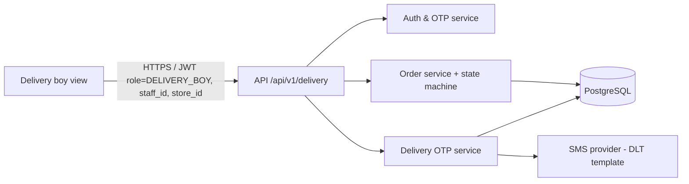
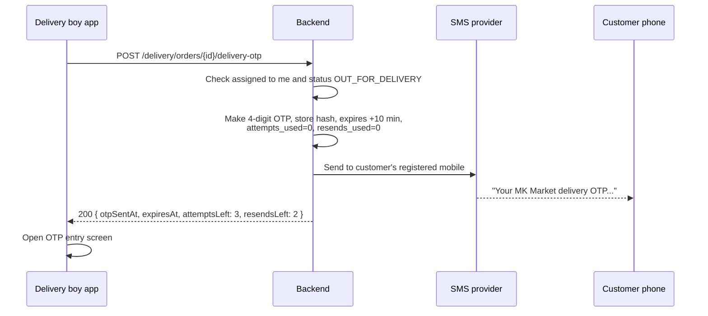

# Technical Specification – Delivery Boy Module

| Item | Value |
| --- | --- |
| Product | MK Market – Product Ordering & Delivery Application |
| Module | Delivery Boy |
| Source | `requirement.md` v1.2 (BRD, 2026-10-07) |
| Spec version | 1.0 (draft for review) |
| Author role | Senior Solution Architect |
| Date | 2026-10-07 |
| Related specs | `../User/spec.md`, `../Store/spec.md` |

---

## 1. Purpose

This spec defines the delivery boy's part of the app: login with a hardcoded number, seeing only assigned orders with the customer's name, mobile and address, marking an order "Delivered" (which sends a 4-digit OTP to the customer), entering the OTP, resends, attempt limits and the move to Undelivered (returned to store).

## 2. Scope

**In scope**

- Login with a hardcoded mobile number and 6-digit OTP
- List of orders assigned to the logged-in delivery boy only
- Customer name, mobile (tap to call), delivery address and map link for each active assigned order
- "Delivered" action, which creates a delivery OTP and sends it by SMS to the customer
- OTP entry: 3 attempts, 2 resends, valid for 10 minutes
- Closing the order as `DELIVERED` on a correct OTP, or `UNDELIVERED` (returned to store) after the 3rd wrong attempt

**Out of scope (BRD §1)**: live location tracking, route navigation inside the app (an external maps link is fine), cash collection, refunds, accepting or declining assignments, self-registration.

## 3. Architecture context



The Delivery OTP service is separate from the login OTP flow. It has its own purpose (`DELIVERY`), length (4), expiry (10 min), attempt and resend counters, and it's always tied to one order.

## 4. Requirement traceability

| BRD item | Covered in |
| --- | --- |
| FR-D-01, US-06, BR-04, FR-G-02, EX-04 | §6.1 |
| FR-D-02, FR-D-03, US-09, BR-17, NFR-03, NFR-04 | §6.2, §6.3, §10 |
| FR-D-04, FR-D-05, FR-U-13, US-10, BR-18 | §6.4 |
| FR-D-06, FR-D-07, FR-D-08, US-11, BR-19, BR-20, EX-13 | §6.5 |
| FR-D-09, EX-14 | §6.6 |
| FR-D-10, BR-21, D6, EX-15 | §6.7 |
| EX-17, EX-18, NFR-11 | §6.8, §12 |
| NFR-02 | §10 |

## 5. Actor and access rules

- Actor: **Delivery boy** (role `DELIVERY_BOY`). Belongs to exactly one store (A3).
- Can see and act only on orders where `orders.delivery_boy_id = token.staff_id` (BR-17, FR-D-02).
- Customer personal data (name, mobile, address) is returned **only while** the order is `OUT_FOR_DELIVERY` and assigned to him. After `DELIVERED` or `UNDELIVERED`, history shows the order ID, area or pincode, outcome and time only (NFR-04).

## 6. Functional design

### 6.1 Login (FR-D-01, FR-G-02, US-06)

Same mechanism as the store manager (see `../Store/spec.md` §6.1):

- Role "Delivery Boy", then mobile, then `POST /auth/otp/request` with `role=DELIVERY_BOY`.
- Number not in the hardcoded staff config as an active delivery boy: **"This number is not registered"**, no SMS (EX-04).
- 6-digit login OTP, valid 5 minutes, resend after 30 s, no lock.
- JWT claims: `role=DELIVERY_BOY`, `staff_id`, `store_id`.

### 6.2 Assigned orders list (FR-D-02, US-09)

| Tab | Shows |
| --- | --- |
| **Active** (default) | Orders assigned to me with status `OUT_FOR_DELIVERY`, oldest assignment first |
| **Completed** | My `DELIVERED` and `UNDELIVERED` orders, last 7 days, with personal data masked |

Card: display order ID, customer name, area and pincode, item count, assigned time, and an "OTP sent" badge if a delivery OTP is active.

Refresh: no push. Polls every 10 seconds while in the foreground, plus pull-to-refresh, so newly dispatched orders show up promptly (US-08 (2)).

### 6.3 Order details (FR-D-03)

- Customer **name**, **mobile** (tap to call), **full address** (house, street, landmark, city, pincode) and an **"Open in Maps"** link using the stored lat/lng (opens the phone's maps app; no in-app tracking)
- Items with quantities (to check against the package), and "Paid in advance – do not collect money"
- Store name (pickup point)
- Primary action: **"Delivered"** (§6.4)

### 6.4 Mark as Delivered and send OTP (FR-D-04, FR-D-05, US-10, BR-18)



- Confirm dialog: "Are you at the customer's location? An OTP will be sent to the customer."
- The OTP is created **only** by this action and sent **only** to the customer's registered mobile (`users.mobile`), never to the address contact or anyone else (BR-18).
- The OTP value is **never** returned to the delivery boy's app or shown on its screen (NFR-02).
- If an OTP for this order is already active and unexpired, the endpoint returns the existing state without sending a new SMS (idempotent). New OTPs go through the resend endpoint (§6.6).
- Order status stays `OUT_FOR_DELIVERY` with sub-state `delivery_otp_status = ACTIVE`. The customer app shows "share the OTP" (User spec §6.7).

### 6.5 Enter OTP (FR-D-06, FR-D-07, FR-D-08, US-11, BR-19, BR-20)

- 4-digit numeric input, submit button, and on-screen counters: "Attempts left: n" and "Resends left: m", plus the expiry countdown.
- `POST /delivery/orders/{id}/delivery-otp/verify` with `{ otp }`.

Server logic (one transaction, row lock on the order's delivery-OTP record):

```
if order.delivery_boy_id != me or order.status != OUT_FOR_DELIVERY -> 409 / 404
if otp.status != ACTIVE -> 409 OTP_NOT_ACTIVE
if now > otp.expires_at -> 400 OTP_EXPIRED (does not use up an attempt; resend if any are left)
attempts_used += 1
if hmac(otp_input) == otp.hash:
    otp.status = USED
    order.status = DELIVERED (conditional on OUT_FOR_DELIVERY)  -> 200 DELIVERED
else if attempts_used < 3:
    -> 400 OTP_INCORRECT { attemptsLeft: 3 - attempts_used }
else:
    otp.status = EXHAUSTED
    order.status = UNDELIVERED, reason = OTP_ATTEMPTS_EXCEEDED -> 200 UNDELIVERED
```

- Correct OTP: "Order delivered" success screen, and the order moves to Completed.
- Wrong OTP: **"Incorrect OTP"** with attempts left (EX-13).
- **Attempt counting:** 3 attempts **per order in total**. A resend gives a new code but **doesn't reset** the attempt count. *This is the architect's reading of BR-19 "up to 3 attempts and 2 resends"; it's the safer one. See OI-D1.*
- Only one OTP is valid at a time. A resend invalidates the earlier one.

**How this matches the BRD's "Undelivered":** while attempts remain, the BRD calls the order "Undelivered" in the sense of *not yet delivered*. In the system it stays `OUT_FOR_DELIVERY` with an active OTP. It becomes the final `UNDELIVERED` status only after the 3rd wrong attempt. This keeps BRD §5.2 (Undelivered is final) consistent with FR-D-08 (retries allowed). See the User spec §7.1. **Needs BA sign-off.**

### 6.6 Resend OTP (FR-D-09, EX-14)

- "Resend OTP" button, enabled 30 s after the last send and while `resends_used < 2`.
- `POST /delivery/orders/{id}/delivery-otp/resend` makes a **new** 4-digit OTP, invalidates the old one, resets the 10-minute expiry, sets `resends_used += 1` and sends the SMS.
- After 2 resends the button is disabled: "No resends left".

### 6.7 Undelivered: returned to store (FR-D-10, BR-21, D6)

- On the 3rd wrong attempt the server sets `UNDELIVERED` with reason `OTP_ATTEMPTS_EXCEEDED`.
- The app shows: "Delivery failed. Please return this order to the store." The order moves to Completed (masked) and shows in the store's **Returned** tab.
- Refund is manual and offline (BR-12). The system takes no refund action.

**Gaps the BRD doesn't fully close (need a decision):**

| Situation | BRD reference | Phase 1 handling in this spec |
| --- | --- | --- |
| Customer not available or refuses (no OTP possible) | EX-15 "Status stays Undelivered, returned to store" | The BRD gives the delivery boy **no** explicit "mark undelivered" action. Proposal: add a **"Customer unavailable / refused – return to store"** action that sets `UNDELIVERED` with a reason. **OI-D2** |
| OTP expired and no resends left | BR-19 | Order stays `OUT_FOR_DELIVERY` with OTP `EXPIRED`. Without OI-D2 it can't be closed. Proposal: let the "return to store" action from OI-D2 cover this too. **OI-D3** |

### 6.8 Network loss while entering OTP (EX-17, NFR-11)

- The status changes only after the server confirms. The app shows "Checking…" and turns off the submit button while the request is in flight.
- Every verify call has an `Idempotency-Key` (made per submit tap). If the network drops, the app retries with the **same key**, and the server returns the stored result instead of using up another attempt.
- On relaunch the app reloads the order and OTP state from `GET /delivery/orders/{id}`.

## 7. Delivery OTP rules (BR-19, A10)

| Parameter | Value |
| --- | --- |
| Length | 4 digits (0000–9999, cryptographically random) |
| Validity | 10 minutes from each send |
| Attempts | 3 per order in total |
| Resends | 2 per order, at least 30 s apart |
| Storage | HMAC-SHA256 with a server secret and the order ID as salt. Never stored in plain text |
| Uniqueness | One active OTP per order. A new OTP replaces the old one |
| Use | Single use: `USED` after a correct entry |
| Delivery | SMS only to the customer's registered mobile |
| Visibility | Never in an API response, log or the delivery boy UI |

Delivery OTP record states: `ACTIVE → USED` | `ACTIVE → EXPIRED` | `ACTIVE → REPLACED` (resend) | `ACTIVE → EXHAUSTED` (3rd wrong attempt).

## 8. API contracts (delivery boy)

Base path `/api/v1`. JWT with `role=DELIVERY_BOY` required (except auth). `staff_id` comes from the token.

| Method & path | Request | Success | Errors |
| --- | --- | --- | --- |
| `POST /auth/otp/request` | `{ "mobile", "role": "DELIVERY_BOY" }` | `200 { "requestId", "resendAfterSec": 30, "expiresInSec": 300 }` | `400 INVALID_MOBILE`, `403 NUMBER_NOT_REGISTERED`, `429 OTP_RESEND_TOO_SOON` |
| `POST /auth/otp/verify` | `{ "requestId", "otp" }` | `200 { "accessToken", "refreshToken", "staff": { "id", "name", "storeId", "storeName" } }` | `400 OTP_INVALID`, `400 OTP_EXPIRED` |
| `GET /delivery/orders` | `tab` (`ACTIVE` or `COMPLETED`), `page`, `size` | `200 { "items": [{ "orderId", "displayOrderId", "customerName"*, "area", "pincode", "itemCount", "assignedAt", "status", "deliveryOtpActive" }] }`. *Masked for COMPLETED | – |
| `GET /delivery/orders/{id}` | – | `200 { ..., "customer": { "name", "mobile" }, "address": {..., "lat", "lng" }, "items": [...], "store": {...}, "deliveryOtp": { "status", "expiresAt", "attemptsLeft", "resendsLeft", "nextResendAt" } }`. Personal data only while `OUT_FOR_DELIVERY` | `404` if not assigned to me |
| `POST /delivery/orders/{id}/delivery-otp` | – | `200 { "otpSentAt", "expiresAt", "attemptsLeft", "resendsLeft" }` | `404`, `409 ORDER_STATE_CHANGED`, `502 SMS_SEND_FAILED` (retryable; no attempt or resend used) |
| `POST /delivery/orders/{id}/delivery-otp/resend` | – | `200 { "otpSentAt", "expiresAt", "resendsLeft" }` | `409 RESEND_LIMIT_REACHED`, `429 RESEND_TOO_SOON`, `409 OTP_NOT_ACTIVE` |
| `POST /delivery/orders/{id}/delivery-otp/verify` | `{ "otp": "1234" }` + `Idempotency-Key` | `200 { "result": "DELIVERED" }` or `200 { "result": "UNDELIVERED", "reason": "OTP_ATTEMPTS_EXCEEDED" }` | `400 OTP_INCORRECT { attemptsLeft }`, `400 OTP_EXPIRED`, `409 OTP_NOT_ACTIVE`, `409 ORDER_STATE_CHANGED` |

## 9. Data model

| Table | Key columns |
| --- | --- |
| `delivery_boys` (from the staff config) | `id`, `store_id`, `code`, `name`, `mobile` UNIQUE, `is_active` |
| `orders` (shared) | `delivery_boy_id`, `assigned_at`, `status`, `delivered_at`, `undelivered_at`, `undelivered_reason`, `version` |
| `delivery_otps` | `id`, `order_id` (one `ACTIVE` per order, partial unique index), `otp_hash`, `status`, `created_at`, `expires_at`, `sent_to_mobile_masked` |
| `delivery_otp_counters` | `order_id` PK, `attempts_used` (3 or fewer), `resends_used` (2 or fewer), `last_sent_at` |
| `idempotency_keys` | `key`, `actor_id`, `endpoint`, `response_json`, `created_at` (24 h TTL) |
| `order_status_history` (shared) | `from_status`, `to_status`, `actor_role`='DELIVERY_BOY' or 'SYSTEM', `actor_id`, `reason`, `at` |

## 10. Security

- Access scoped by `delivery_boy_id = token.staff_id`. Other orders return 404 (BR-17, NFR-03).
- **Personal data minimisation** (NFR-04): name, mobile and address are returned only while the order is `OUT_FOR_DELIVERY` and assigned to the caller. The app doesn't cache personal data on disk, and clears it on logout or when the order is completed. Screenshot blocking (`FLAG_SECURE` on Android) is recommended on the details screen.
- The delivery OTP is never in an API response, push payload, log line or analytics event (NFR-02).
- OTP verification uses a row lock or atomic counter update, so parallel submits can't get more than 3 attempts.
- Staff session inactivity timeout: **12 hours proposed** (NFR-06).

## 11. Non-functional design

| NFR | Design |
| --- | --- |
| NFR-09 OTP SMS < 30 s | Transactional DLT route, async send with 1 retry on a fallback route. `SMS_SEND_FAILED` shown if both fail |
| NFR-11 | Idempotency keys on verify, conditional status updates, server-authoritative state |
| NFR-12 | Message catalogue below |

| Case | Message |
| --- | --- |
| Unregistered number | "This number is not registered" |
| OTP sent | "OTP sent to the customer's phone. Ask the customer to share it." |
| Wrong OTP | "Incorrect OTP. {n} attempts left." |
| OTP expired | "OTP has expired. Tap Resend to send a new one." |
| No resends left | "No resends left." |
| 3rd wrong attempt | "Delivery failed after 3 incorrect OTPs. Please return this order to the store." |
| SMS failed | "Couldn't send the OTP. Please try again." |
| Network lost | "No connection. Your entry hasn't been lost. Retrying…" |

## 12. Edge cases

| BRD | Handling |
| --- | --- |
| EX-04 | No OTP, "not registered" |
| EX-13 | "Incorrect OTP", attempts counted, `UNDELIVERED` after the 3rd |
| EX-14 | Resend (up to 2, 30 s apart) |
| EX-15 | See OI-D2 (proposed "return to store" action) |
| EX-17 | Idempotent verify, status changes only on server confirmation |
| EX-18 | Conditional updates. The second actor sees the refreshed status |
| Delivery boy taps "Delivered" twice | Second call returns the existing active OTP state, no duplicate SMS |
| Customer gives an OTP from a replaced (older) SMS | Counts as incorrect. The message suggests using the latest SMS |

## 13. Acceptance test scenarios

| # | Scenario | Expected |
| --- | --- | --- |
| D-T01 | Hardcoded delivery boy number, correct OTP | Delivery view for their store |
| D-T02 | Unregistered number | "This number is not registered", no SMS |
| D-T03 | Store assigns an order to DB001 | It shows in DB001's Active list. DB002 doesn't see it |
| D-T04 | DB002 opens DB001's order ID via the API | 404 |
| D-T05 | Open an assigned order | Name, mobile, address and map link shown |
| D-T06 | Tap Delivered | Customer gets a 4-digit SMS. OTP screen opens. OTP not visible to the delivery boy |
| D-T07 | Enter the correct OTP | Status `DELIVERED`, customer sees Delivered |
| D-T08 | Wrong OTP once | "Incorrect OTP. 2 attempts left.", status unchanged |
| D-T09 | Three wrong OTPs | Status `UNDELIVERED`, shows in the store's Returned tab |
| D-T10 | Resend twice | Two new SMS. Third resend blocked. Old OTPs rejected |
| D-T11 | Enter the OTP 11 minutes after sending | "OTP has expired", attempt not used |
| D-T12 | Airplane mode during verify, then reconnect | One result recorded, attempt counted once |
| D-T13 | Completed order details | Customer personal data masked |
| D-T14 | API responses and logs | No plain-text OTP anywhere |

## 14. Open items and architect's decisions to confirm

| # | Item | Proposed resolution |
| --- | --- | --- |
| OI-D1 | Are the 3 attempts per order or per OTP? | Per order (resend doesn't reset). Safer against guessing |
| OI-D2 | EX-15: no BRD action to mark Undelivered when the customer is unavailable or refuses | Add a "Customer unavailable / refused – return to store" action with a reason |
| OI-D3 | OTP expired with no resends left | Use the OI-D2 action. Otherwise the order stays open |
| OI-D4 | "Undelivered" during retries vs. final (BRD §5.2 vs. FR-D-08) | `OUT_FOR_DELIVERY` + OTP sub-state until the 3rd wrong attempt, then final `UNDELIVERED` |
| OI-D5 | Staff session timeout | 12 hours |
| OI-D6 | Delivery boy with several active orders at once | Allowed (A7). Each order has its own OTP and counters |
