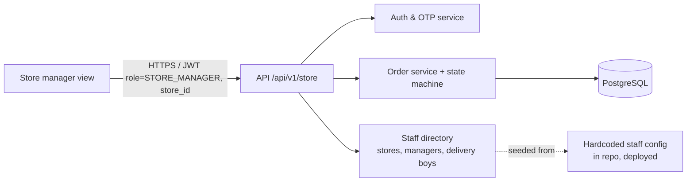
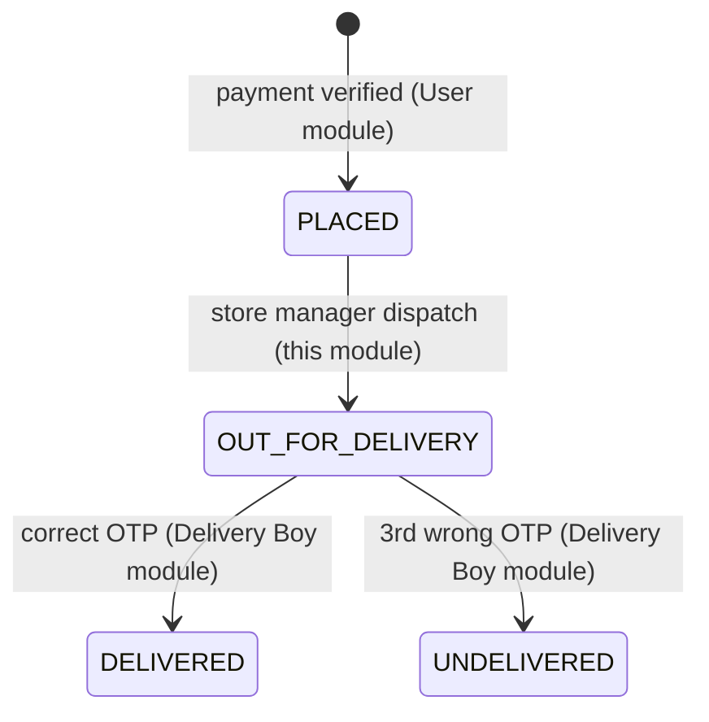

# Technical Specification – Store (Store Manager) Module

| Item | Value |
| --- | --- |
| Product | MK Market – Product Ordering & Delivery Application |
| Module | Store (Store Manager) |
| Source | `requirement.md` v1.2 (BRD, 2026-10-07) |
| Spec version | 1.0 (draft for review) |
| Author role | Senior Solution Architect |
| Date | 2026-10-07 |
| Related specs | `../User/spec.md`, `../Delivery Boy/spec.md` |

---

## 1. Purpose

This spec defines the store manager's part of the app: login with a hardcoded number, getting orders routed to the store, seeing order details and placed time, and assigning a delivery boy, which in the same step moves the order to "On the way for delivery".

## 2. Scope

**In scope**

- Login with a hardcoded mobile number and 6-digit OTP (no sign-up)
- Order inbox for the manager's own store (orders are routed by the system)
- Order details: order ID, items, amount, delivery address, customer name and mobile, order placed time
- Assigning one delivery boy of the same store, which sets status to `OUT_FOR_DELIVERY` in one action
- Read-only view of orders in progress, delivered and undelivered (returned to store) for the store

**Out of scope (BRD §1)**: rejecting orders, cancellation, refunds, product, inventory and price management, managing delivery boys, reports and analytics, admin panel, live tracking of delivery boys.

## 3. Architecture context

This is the store manager view inside the single mobile app (A13). It uses the shared backend services (Auth & OTP, Order service, Staff directory). Order routing happens **in the User module at checkout** (see `../User/spec.md` §6.5). This module only consumes orders that are already routed.



## 4. Requirement traceability

| BRD item | Covered in |
| --- | --- |
| FR-S-01, US-06, BR-04, FR-G-02, EX-04, A15 | §6.1, §7.1 |
| FR-S-02, BR-14, US-07 (1) | §6.2 |
| FR-S-03, FR-S-04, US-07 (2), D4 | §6.3, §6.4 |
| FR-S-05, US-08, BR-15, BR-16, A7, A8 | §6.5 |
| FR-S-06, US-07 (3), BR-13, D5 | §6.6 |
| FR-G-01, BR-22, EX-18 | §6.5, §8 |
| EX-10, EX-11, EX-12 | §12 |
| BR-21, D6 (undelivered back to store) | §6.7 |
| NFR-03, NFR-08 | §10, §11 |

## 5. Actor and access rules

- Actor: **Store manager** (role `STORE_MANAGER`). Each store has **exactly one** manager login (A3).
- A manager can read and act only on orders where `orders.store_id = token.store_id` (NFR-03, BR-15).
- A manager can assign only delivery boys where `delivery_boys.store_id = token.store_id` (BR-16).
- A manager can see customer name, mobile and address for their store's orders (BRD §2 permission matrix).

## 6. Functional design

### 6.1 Login with a hardcoded number (FR-S-01, FR-G-02, US-06)

1. On the role selection screen the manager picks "Store Manager".
2. They enter a 10-digit mobile number (`+91` fixed).
3. `POST /auth/otp/request` with `role=STORE_MANAGER`.
   - The number isn't in the staff directory as an active store manager: return `403 NUMBER_NOT_REGISTERED`, show **"This number is not registered"**, **no SMS sent** (EX-04).
   - Registered: 6-digit OTP, valid 5 minutes, resend after 30 s, no lock (BR-02, BR-03). Same mechanism as the customer login.
4. `POST /auth/otp/verify` returns a JWT with `role=STORE_MANAGER`, `staff_id` and `store_id`.

**How the hardcoded numbers work (A15):** store managers and delivery boys are defined in a version-controlled config file in the backend repo (for example `config/staff.yaml`) and upserted into the `stores`, `store_managers` and `delivery_boys` tables on deployment. There's no API or UI to change them. Changing a number means a code change plus a deployment by the development team, as the BRD requires.

```yaml
# config/staff.yaml (illustrative)
stores:
  - code: STR001
    name: MK Market – Kothrud
    lat: 18.5074
    lng: 73.8077
    active: true
    manager: { name: "Store Manager 1", mobile: "9XXXXXXXXX" }
    deliveryBoys:
      - { code: DB001, name: "Delivery Boy 1", mobile: "9XXXXXXXXX" }
      - { code: DB002, name: "Delivery Boy 2", mobile: "9XXXXXXXXX" }
```

Constraint: one mobile number belongs to one role and one store at a time (unique index across staff). A staff number may also be used as a customer number. The role picked at login decides the session.

### 6.2 Order routing to the store (FR-S-02, BR-14)

- Routing is decided **once**, at checkout: the nearest store by road distance, 4 km or less (User spec §6.5). The chosen `store_id` is locked in the checkout and copied to the order when payment succeeds.
- An order belongs to **exactly one** store and is never re-routed (there's no reject or reassign-store feature).
- The order is committed as `PLACED` in the same transaction that records the captured payment, so it's visible to the store right away.

### 6.3 Order inbox (FR-S-03, US-07)

Tabs and filters:

| Tab | Shows | Sort |
| --- | --- | --- |
| **New** (default) | `PLACED` | Oldest placed first (FIFO), so waiting orders get attention |
| **On the way** | `OUT_FOR_DELIVERY` | Assigned time, newest first |
| **Returned** | `UNDELIVERED` (returned to store, BR-21) | Newest first |
| **Delivered** | `DELIVERED`, last 7 days by default | Newest first |

List card: display order ID, **order placed time** (absolute time, for example "07 Oct, 10:42 AM", plus "18 min ago"), item count, amount, area or pincode, status.

Freshness (NFR-08, within 10 s): there's no push (A9). The **New** tab **polls every 5 seconds** while in the foreground (`GET /store/orders?status=PLACED&since=<cursor>`), plus pull-to-refresh. A new order shows a "New" highlight and an in-app sound or vibration while the app is open. A WebSocket/SSE channel can replace polling later without changing the API.

### 6.4 Order details (FR-S-04, D4)

Shows:

- Display order ID and status
- **Order placed time** (date, time, how long ago). This is the "check order time" the client asked for (D4)
- Items: name, unit, qty, unit price, line total, and order total (paid in advance)
- Customer name, mobile (tap to call, which supports EX-10 manual calls) and full delivery address with landmark and pincode, plus a "View on map" link
- Payment: "Paid in advance", method, gateway reference (last 6 characters)
- Status timeline with times; assigned delivery boy once assigned
- For `UNDELIVERED`: the reason (for example "3 incorrect OTP attempts") and the label "Returned to store – refund handled manually"

### 6.5 Assign delivery boy and set "On the way" in one action (FR-S-05, US-08, A8)

1. On a `PLACED` order, the manager taps **"Assign delivery boy"**.
2. A sheet lists **all active delivery boys of this store** with name, mobile and their current count of `OUT_FOR_DELIVERY` orders (shown for information only; no limit, A7).
3. The manager picks one and taps **"Confirm – Send for delivery"**.
4. `POST /store/orders/{orderId}/dispatch` with `{ deliveryBoyId }`.
5. The server, in **one transaction**:
   - checks that the order belongs to the token's store and the delivery boy belongs to the same store and is active
   - runs `UPDATE orders SET status='OUT_FOR_DELIVERY', delivery_boy_id=:db, assigned_at=now(), version=version+1 WHERE id=:id AND status='PLACED' AND store_id=:store`
   - if 0 rows change, returns `409 ORDER_STATE_CHANGED` with the current order (EX-18)
   - writes `order_status_history` (actor = manager)
6. The order moves to the **On the way** tab and **appears in the delivery boy's list** on their next poll (US-08).

Rules:

- One delivery boy per order (BR-16). There is **no reassign** after dispatch in this phase. *If the client wants reassignment (for example the delivery boy falls sick), it's a change request. See OI-S2.*
- Assignment and status change are one atomic API call. The UI has no separate status dropdown (A8).

### 6.6 No reject or cancel (FR-S-06, BR-13)

- There's no reject, cancel or "change status" action for the manager, and no such endpoint exists.
- The only state-changing endpoint for this role is `dispatch` (§6.5).

### 6.7 Returned (undelivered) orders (BR-21, D6, EX-15)

- An order becomes `UNDELIVERED` through the Delivery Boy module (3 wrong OTPs). It then shows in the store's **Returned** tab, read-only.
- Physically returning the goods and refunding the customer are **manual, offline** processes (BR-12). The system only records the status. *Optional: a "Goods received back" checkbox for audit. Not in the BRD; see OI-S3.*

## 7. Shared contracts used by this module

### 7.1 Staff directory

| Table | Key columns |
| --- | --- |
| `stores` | `id` UUID, `code` UNIQUE, `name`, `location` GEOGRAPHY(Point), `address`, `is_active` |
| `store_managers` | `id`, `store_id` UNIQUE (one manager per store), `name`, `mobile` UNIQUE, `is_active` |
| `delivery_boys` | `id`, `store_id`, `code`, `name`, `mobile` UNIQUE, `is_active` |

### 7.2 Order lifecycle (owned by the Order service)



The only transition this module is allowed to make is `PLACED → OUT_FOR_DELIVERY`. See the User spec §7.1 for how the BRD's Undelivered inconsistency is resolved.

## 8. API contracts (store manager)

Base path `/api/v1`. JWT with `role=STORE_MANAGER` required (except the auth endpoints). `store_id` always comes from the token and is **never** a request parameter.

| Method & path | Request | Success | Errors |
| --- | --- | --- | --- |
| `POST /auth/otp/request` | `{ "mobile", "role": "STORE_MANAGER" }` | `200 { "requestId", "resendAfterSec": 30, "expiresInSec": 300 }` | `400 INVALID_MOBILE`, `403 NUMBER_NOT_REGISTERED`, `429 OTP_RESEND_TOO_SOON` |
| `POST /auth/otp/verify` | `{ "requestId", "otp" }` | `200 { "accessToken", "refreshToken", "staff": { "id", "name", "storeId", "storeName" } }` | `400 OTP_INVALID`, `400 OTP_EXPIRED` |
| `GET /store/orders` | `status` (`PLACED`, `OUT_FOR_DELIVERY`, `UNDELIVERED`, `DELIVERED`), `since`, `page`, `size` | `200 { "items": [{ "orderId", "displayOrderId", "placedAt", "itemCount", "totalAmount", "pincode", "area", "status" }], "cursor" }` | `401` |
| `GET /store/orders/{orderId}` | – | `200 { ...full order, "customer": { "name", "mobile" }, "address": {...}, "items": [...], "payment": {...}, "deliveryBoy"?: {...}, "timeline": [...], "undeliveredReason"? }` | `404` if not this store's order |
| `GET /store/delivery-boys` | – | `200 { "items": [{ "id", "name", "mobile", "activeOrders" }] }` | – |
| `POST /store/orders/{orderId}/dispatch` | `{ "deliveryBoyId" }` + header `Idempotency-Key` | `200 { "orderId", "status": "OUT_FOR_DELIVERY", "deliveryBoy": {...}, "assignedAt" }` | `404 ORDER_NOT_FOUND`, `409 ORDER_STATE_CHANGED { currentStatus }`, `422 DELIVERY_BOY_NOT_IN_STORE`, `422 DELIVERY_BOY_INACTIVE` |

## 9. Screens

| Screen | Key elements |
| --- | --- |
| S-01 Role select / mobile entry | Shared with other roles |
| S-02 OTP | 6 boxes, 30 s resend timer |
| S-03 Order inbox | Tabs New / On the way / Returned / Delivered, order cards with placed time, new-order highlight |
| S-04 Order details | §6.4 content, "Assign delivery boy" button (only when `PLACED`) |
| S-05 Assign sheet | Delivery boy list, single select, "Confirm – Send for delivery" |
| S-06 Profile | Store name, manager name, logout |

## 10. Security

- Login only for numbers in the staff directory. Unregistered numbers get no OTP (stops SMS abuse and makes it clear who can sign in).
- Every query is scoped by the token's `store_id`. Cross-store IDs return 404 (NFR-03).
- Customer personal data is shown only for this store's orders. Personal data is masked in logs.
- Staff session: access token 15 minutes; **inactivity timeout 12 hours proposed** (one shift) (NFR-06, to confirm).
- Every dispatch is written to `order_status_history` with the manager ID and timestamp for audit.

## 11. Non-functional design

| NFR | Design |
| --- | --- |
| NFR-08 (order in list within 10 s) | Order committed with the payment. New tab polls every 5 s. Index on `(store_id, status, placed_at)` |
| NFR-10 | Stateless API, shared HA database |
| NFR-11 | `Idempotency-Key` on dispatch. Conditional update makes repeats safe |
| NFR-12 | Message catalogue below |

Messages:

| Case | Message |
| --- | --- |
| Unregistered number | "This number is not registered" |
| Someone else already changed the order | "This order was already updated. Showing the latest status." |
| Delivery boy not available | "This delivery boy is no longer available. Please choose another." |
| No delivery boys configured | "No delivery boys are set up for your store. Please contact support." |

## 12. Edge cases

| BRD | Handling |
| --- | --- |
| EX-04 | `NUMBER_NOT_REGISTERED`, no SMS |
| EX-10 out of stock after payment | Manager calls the customer from the order details (tap to call). The system has no status for this. The order is either dispatched or left `PLACED`. *Gap: there's no system path to close such an order. See OI-S1* |
| EX-11 manager doesn't act | No timeout, order stays `PLACED`. The FIFO sort and "x min ago" make waiting orders easy to see |
| EX-12 no delivery boy available | Order stays `PLACED` until dispatched |
| EX-18 concurrent action | Conditional update. The second caller gets `409` and the refreshed order |
| Manager taps Confirm twice / network retry | Same `Idempotency-Key`, same result, no duplicate history entry |

## 13. Acceptance test scenarios

| # | Scenario | Expected |
| --- | --- | --- |
| S-T01 | Hardcoded manager number, correct OTP | Logged into the store inbox for their store |
| S-T02 | Number not in staff config | "This number is not registered", no SMS sent |
| S-T03 | Customer pays for an order routed to store A | Shows in store A's New tab within 10 s, not in store B |
| S-T04 | Open the order | Shows ID, items, address, customer details, placed time |
| S-T05 | Assign DB001 of store A | Status `OUT_FOR_DELIVERY`, order shows in DB001's list |
| S-T06 | Try to assign a delivery boy of store B (API tamper) | `422 DELIVERY_BOY_NOT_IN_STORE` |
| S-T07 | Dispatch an order that's already `OUT_FOR_DELIVERY` | `409 ORDER_STATE_CHANGED` |
| S-T08 | Two devices dispatch at the same time | One succeeds, the other gets 409 |
| S-T09 | Open store B's order ID | 404 |
| S-T10 | Look for a reject or cancel action | None in the UI, no endpoint |
| S-T11 | Delivery fails after 3 wrong OTPs | Order shows in the Returned tab with the reason |

## 14. Open items and architect's decisions to confirm

| # | Item | Proposed resolution |
| --- | --- | --- |
| OI-S1 | EX-10: out of stock after payment, but there's no reject option, so the order has no way to close in the system | Phase 1: stays `PLACED` and is handled offline. Recommend adding a store-side "Close – not fulfilled" action as a change request |
| OI-S2 | Reassigning a delivery boy after dispatch | Not supported (BR-16, A8). Change request if needed |
| OI-S3 | Confirming goods were physically returned for `UNDELIVERED` | Optional audit checkbox, not in the BRD |
| OI-S4 | Staff session inactivity timeout | 12 hours |
| OI-S5 | Polling vs. WebSocket for the inbox | Polling every 5 s for phase 1. Can move to WebSocket/SSE later |
| OI-S6 | Store inactive or closed hours | Not in the BRD. Inactive stores (`is_active=false`) are left out of routing; no opening hours in phase 1 |
