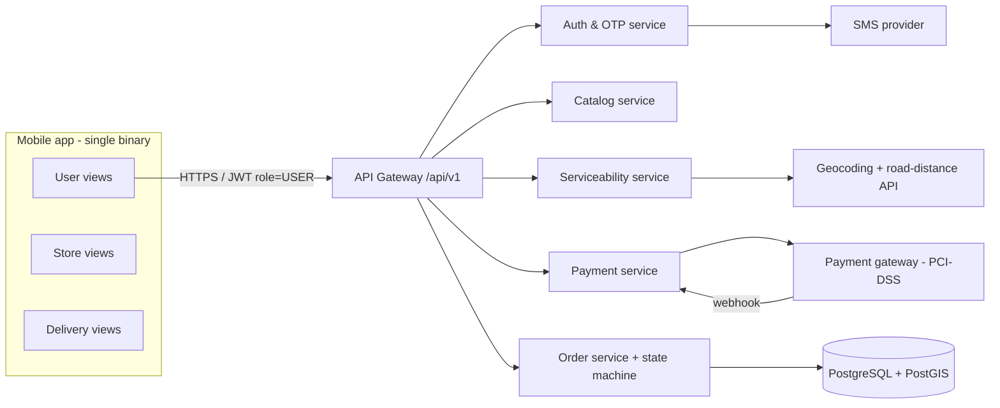
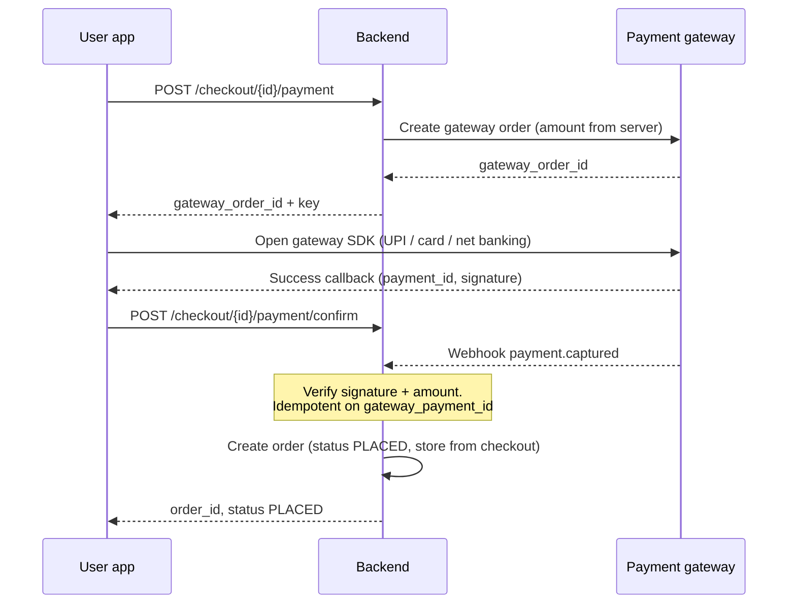
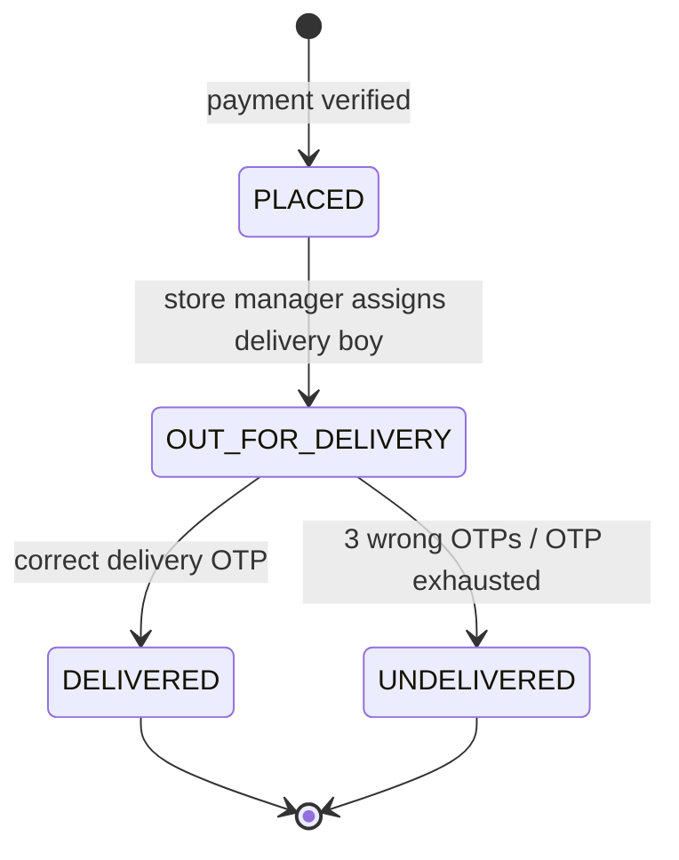
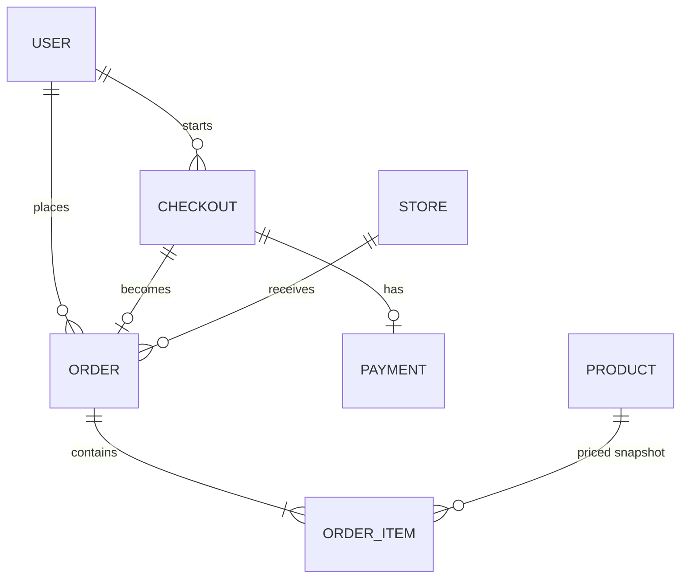

# Technical Specification – User (Customer) Module

| Item | Value |
| --- | --- |
| Product | MK Market – Product Ordering & Delivery Application |
| Module | User (Customer) |
| Source | `requirement.md` v1.2 (BRD, 2026-10-07) |
| Spec version | 1.0 (draft for review) |
| Author role | Senior Solution Architect |
| Date | 2026-10-07 |
| Related specs | `../Store/spec.md`, `../Delivery Boy/spec.md` |

---

## 1. Purpose

This spec turns the BRD into a buildable design for the customer side of the app: login, product search, address capture, serviceability check (store within 4 km by road), advance payment, order creation, order status tracking and display of the delivery OTP to the customer.

## 2. Scope

**In scope (this module)**

- Mobile number + 6-digit OTP login (Indian numbers only)
- Product search by name, and selecting products and quantities for an order
- Capturing one delivery address per order (basic details and mandatory pincode)
- Serviceability check: the nearest store by road within 4 km
- Full advance payment through the payment gateway (UPI, card, net banking)
- Creating the order only after the gateway confirms payment
- Order confirmation with order ID
- "My orders" list and order status (in-app only, no push)
- Getting the delivery OTP by SMS when the delivery boy taps "Delivered"

**Out of scope (from BRD §1)**: cancellation, in-app refunds, persistent cart, wishlist, coupons, offers, ratings, reviews, delivery charges, minimum order value, push notifications, live tracking, COD.

## 3. Architecture context

All three modules are role-based views inside **one mobile app** (Android + iOS, A13) backed by **one shared backend**. This module owns the customer screens and the customer-facing APIs. It uses these shared platform services:



**Recommended baseline stack** (to be confirmed by the delivery team; the BRD doesn't name one):

| Layer | Recommendation | Reason |
| --- | --- | --- |
| Mobile | Flutter or React Native (one codebase) | A13: one app for Android and iOS |
| Backend | Node.js (NestJS) or Java (Spring Boot), REST/JSON | Standard, well supported |
| Database | PostgreSQL + PostGIS | Transactions for order/payment; geo prefilter for stores |
| Maps | Google Maps Geocoding + Distance Matrix (or a similar Indian provider) | BR-08 needs **road** distance, not straight-line |
| Payment | Razorpay / PayU / Cashfree | A1: standard Indian gateway with UPI, card, net banking |
| SMS | MSG91 / Gupshup / Twilio (DLT-registered templates) | OTP SMS in India needs DLT registration |

## 4. Requirement traceability

| BRD item | Covered in |
| --- | --- |
| FR-U-01, FR-U-02, US-01, BR-01–03, EX-01–03 | §6.1, §8.1, §10 |
| FR-U-03, FR-U-04, US-02, EX-05, NFR-07 | §6.2, §8.2 |
| FR-U-05, BR-05 | §6.3, §8.3 |
| FR-U-06, US-03, BR-06, BR-07, EX-06 | §6.4, §8.4 |
| FR-U-07, FR-U-08, BR-08, BR-14, EX-07 | §6.5, §7.2, §8.4 |
| FR-U-09, FR-U-10, FR-U-11, US-04, BR-09–11, EX-08, EX-09 | §6.6, §7.3, §8.5 |
| FR-U-12, FR-U-14, US-05, BR-13, EX-16 | §6.7, §8.6 |
| FR-U-13, BR-18 | §6.8 |
| NFR-01–12 | §11, §12 |

## 5. Actor and access rules

- Actor: **Customer** (role `USER`). Anyone with a valid Indian mobile number can sign in; the account is created automatically on first successful OTP.
- A customer sees only their own orders. Every order API filters by `user_id` from the token; it never trusts a user ID sent from the client.
- A customer can't cancel or change an order once it's placed (BR-13).

## 6. Functional design

### 6.1 Login (FR-U-01, FR-U-02, US-01)

1. On the role selection screen the customer picks "Customer".
2. They enter a 10-digit mobile number. The `+91` prefix is fixed and can't be edited.
3. Client-side check: exactly 10 digits, starting with 6–9. If it fails, show EX-01 and make no API call.
4. `POST /auth/otp/request` with role `USER`. The server makes a 6-digit OTP, stores only its hash, sets a 5-minute expiry and sends it by SMS.
5. The OTP screen shows a 30-second countdown, then enables "Resend OTP" (EX-03).
6. `POST /auth/otp/verify`. On success the server creates the user if new and returns access and refresh tokens.
7. A wrong or expired OTP shows an error. The customer stays on the screen and can retry or resend. **No account lock** (BR-03).

Anti-abuse (architect's recommendation, not an account lock): limit OTP SMS to 5 sends per number per hour and 10 verify attempts per OTP. After that the earlier OTP is invalidated and the user must request a new one. This protects SMS cost while still respecting BR-03. **Needs BA/client acknowledgement.**

### 6.2 Product search (FR-U-03, FR-U-04, US-02)

- Search box with a 300 ms debounce. At least 2 characters before calling the API.
- Matching: case-insensitive prefix and substring match on product name (A4: name only). Use a PostgreSQL `pg_trgm` GIN index to meet NFR-07 (< 2 s at P95).
- Results show: product image, name, unit/pack size, price (INR) and an "Add" control.
- Results are paged (20 per page, infinite scroll).
- No match: show "No products found" (EX-05).
- The catalog is **global** (A2). Stock isn't checked per store at search time; out-of-stock after payment is handled manually (EX-10).

### 6.3 Order selection (FR-U-05, BR-05)

- The customer adds products and sets quantities. This is an **on-device selection** for the current order only. It isn't a saved cart (a cart is out of scope).
- Quantity per line: 1 to 10 (proposed default, configurable).
- "Proceed" is enabled only when at least 1 product is selected (BR-05).
- Prices shown are indicative. The **server recalculates the amount** from catalog prices when it creates the checkout (§6.6), and the client's amount is never trusted.
- No delivery charge and no minimum order value (BR-23).

### 6.4 Delivery address (FR-U-06, US-03, BR-06, BR-07)

| Field | Required | Rule |
| --- | --- | --- |
| Full name | Yes | 2–60 characters |
| House / flat number | Yes | 1–50 characters |
| Street / area | Yes | 2–100 characters |
| Landmark | No | Up to 100 characters |
| City | Yes | 2–50 characters |
| Pincode | Yes | Exactly 6 digits, first digit 1–9 |
| Map pin (lat/lng) | Recommended | Set from GPS or by dragging a pin. This makes road-distance checks much more accurate than geocoding text alone |

- Missing or invalid fields are highlighted in place and "Continue" is blocked (EX-06).
- One address per order (A5). Recently used addresses can be offered for quick selection (convenience only). Saved addresses aren't a separate feature.

### 6.5 Serviceability check (FR-U-07, FR-U-08, BR-08, BR-14)

Runs when the customer taps "Continue" on the address screen, before any payment.

1. Resolve the address to coordinates: use the map pin if there is one, otherwise geocode the address text and pincode.
2. **Prefilter**: find active stores within 4 km straight-line distance (PostGIS `ST_DWithin`). Road distance is always at least the straight-line distance, so no eligible store is missed.
3. **Road distance**: call the Distance Matrix API from the address to each candidate store (driving mode).
4. Pick the store with the **smallest road distance that is 4,000 m or less**. On a tie, pick the lowest `store_id` (deterministic).
5. No store qualifies: return `NO_STORE_AVAILABLE` and show **"Currently no store is available in your area"**. The payment step is blocked.
6. A store qualifies: create a **checkout session** that locks `store_id`, the address, the server-priced line items and the total amount. The session is valid for 15 minutes.

The store is **locked at checkout** so the order goes to exactly the store that was checked (BR-14), even if a new store comes online during payment.

If the Maps API fails, return `SERVICEABILITY_UNAVAILABLE` and show "We couldn't check delivery to this address right now. Please try again." Never default to "serviceable".

### 6.6 Advance payment and order creation (FR-U-09, FR-U-10, FR-U-11, US-04)



Rules:

- The order is created **only** when the server verifies success, either through the signature on the client confirm or the gateway webhook, whichever arrives first. The other is a no-op (idempotent on `gateway_payment_id`, unique constraint) (BR-10, NFR-11).
- The server checks that the captured amount equals the checkout amount, and the currency is INR.
- Failed, cancelled or timed-out payment: no order. Show "Payment failed. No money was taken for an order. Please try again." with a **Retry** button that reuses the same checkout session while it's still valid (EX-08, BR-11).
- **Payment debited but no confirmation** (EX-09): the app shows a "Confirming payment…" state and polls `GET /checkout/{id}` for up to 2 minutes. If there's still no confirmation, show "We couldn't confirm your payment. If money was debited, it will be refunded. Please contact support." No order is created.
- **Late webhook** (after the checkout has expired): don't create an order. Mark the payment `CAPTURED_ORPHAN` so it goes to manual refund (BR-12). *Architect's interpretation of EX-09; confirm with BA.*
- Confirmation screen shows: order ID, items, amount paid, delivery address, status "Placed".
- Order ID format: `MK` + `YYMMDD` + 6 uppercase alphanumeric characters (for example `MK261007A3F9K2`). Readable over the phone; internal primary key is a UUID.

### 6.7 My orders and status (FR-U-12, FR-U-14, US-05)

- List view: order ID, date and time placed, item count, amount, status badge. Newest first.
- Detail view: items, address, amount, status timeline (Placed → On the way for delivery → Delivered / Undelivered) with timestamps.
- Status refresh: no push (A9). The app **polls every 15 seconds while the order screen is in the foreground** and supports pull-to-refresh.
- Customer-facing status labels:

| Internal status | Shown to customer |
| --- | --- |
| `PLACED` | Placed |
| `OUT_FOR_DELIVERY` | On the way for delivery |
| `OUT_FOR_DELIVERY` with delivery OTP active | On the way for delivery – share the OTP sent to your phone with the delivery person |
| `DELIVERED` | Delivered |
| `UNDELIVERED` | Undelivered – returned to store. Any refund will be processed manually. |

- **No cancel, edit or reject action exists anywhere** in the customer UI or API (FR-U-14, EX-16).

### 6.8 Delivery OTP (FR-U-13, BR-18, BR-19)

- Created by the Delivery Boy module (see `../Delivery Boy/spec.md` §6.4). The customer gets it **by SMS only** to the registered mobile number.
- The SMS template (DLT): "Your MK Market delivery OTP for order {orderId} is {otp}. Share it only with the delivery person at your door. Valid for 10 minutes."
- The OTP is **not** shown on the delivery boy's screen (NFR-02). By default it's also not shown in the customer app; SMS is the channel the BRD names. *Showing it in the customer app as a backup is a possible improvement for the client to decide.*

## 7. Shared contracts used by this module

### 7.1 Order status lifecycle (single source: Order service)



- Transitions are enforced only on the server, with conditional updates (`UPDATE … WHERE status = :expected`) (BR-22, FR-G-01, EX-18).
- **BRD inconsistency resolved here:** BRD §5.2 calls Undelivered final, but FR-D-08 and EX-13 say a wrong OTP "keeps" the order Undelivered while allowing retries. This spec keeps the order `OUT_FOR_DELIVERY` (with a delivery-OTP sub-state) during attempts, and moves it to the final `UNDELIVERED` only after the 3rd wrong attempt. The customer-visible behaviour is the same as the BRD. **Needs BA sign-off.**

### 7.2 Serviceability result

```json
{ "serviceable": true, "checkoutId": "uuid", "storeId": "uuid", "roadDistanceMeters": 2870, "expiresAt": "ISO-8601" }
```

### 7.3 Payment states

`CREATED → AUTHORIZED → CAPTURED` (order created) | `FAILED` | `CANCELLED` | `EXPIRED` | `CAPTURED_ORPHAN` (manual refund)

## 8. API contracts (customer)

Base path `/api/v1`. All endpoints except OTP request and verify need `Authorization: Bearer <JWT>` with `role=USER`.

Standard error body:

```json
{ "error": { "code": "NO_STORE_AVAILABLE", "message": "Currently no store is available in your area" } }
```

### 8.1 Auth

| Method & path | Body | Success | Errors |
| --- | --- | --- | --- |
| `POST /auth/otp/request` | `{ "mobile": "9876543210", "role": "USER" }` | `200 { "requestId", "resendAfterSec": 30, "expiresInSec": 300 }` | `400 INVALID_MOBILE`, `429 OTP_RESEND_TOO_SOON`, `429 OTP_RATE_LIMIT` |
| `POST /auth/otp/verify` | `{ "requestId", "otp": "123456" }` | `200 { "accessToken", "refreshToken", "user": { "id", "mobile", "role" } }` | `400 OTP_INVALID`, `400 OTP_EXPIRED` |
| `POST /auth/token/refresh` | `{ "refreshToken" }` | `200 { "accessToken", "refreshToken" }` | `401 SESSION_EXPIRED` |
| `POST /auth/logout` | – | `204` | – |

### 8.2 Catalog

| Method & path | Params | Success |
| --- | --- | --- |
| `GET /products/search` | `q` (2 or more characters), `page`, `size` (20 or fewer) | `200 { "items": [{ "id", "name", "unit", "price", "imageUrl" }], "page", "hasMore" }`. An empty `items` array means the app shows "No products found" |

### 8.3 / 8.4 Checkout and serviceability

| Method & path | Body | Success | Errors |
| --- | --- | --- | --- |
| `POST /checkout` | `{ "items": [{ "productId", "qty" }], "address": { "name", "house", "street", "landmark", "city", "pincode", "lat", "lng" } }` | `201 { "checkoutId", "storeId", "items": [...server-priced], "totalAmount", "currency": "INR", "expiresAt" }` | `400 EMPTY_ORDER`, `400 INVALID_ADDRESS { fields: [...] }`, `422 NO_STORE_AVAILABLE`, `503 SERVICEABILITY_UNAVAILABLE` |
| `GET /checkout/{id}` | – | `200 { "status": "OPEN" \| "PAID" \| "FAILED" \| "EXPIRED", "orderId"? }` | `404` |

### 8.5 Payment

| Method & path | Body | Success | Errors |
| --- | --- | --- | --- |
| `POST /checkout/{id}/payment` | – | `200 { "gatewayOrderId", "gatewayKey", "amount" }` | `409 CHECKOUT_EXPIRED`, `409 ALREADY_PAID` |
| `POST /checkout/{id}/payment/confirm` | `{ "gatewayPaymentId", "gatewayOrderId", "signature" }` | `200 { "orderId", "displayOrderId", "status": "PLACED" }` | `400 PAYMENT_VERIFICATION_FAILED`, `402 PAYMENT_FAILED` |
| `POST /webhooks/payment` (server to server) | Gateway payload | `200` | Signature checked with the webhook secret. Not exposed to the app |

### 8.6 Orders

| Method & path | Success |
| --- | --- |
| `GET /orders?page=&size=` | `200 { "items": [{ "orderId", "displayOrderId", "placedAt", "itemCount", "totalAmount", "status" }] }` |
| `GET /orders/{orderId}` | `200 { ...summary, "items": [...], "address": {...}, "timeline": [{ "status", "at" }], "deliveryOtpActive": bool }`. Returns `404` if the order isn't the caller's |

There is deliberately **no** `PATCH`, `DELETE` or cancel endpoint for customers.

## 9. Data model (entities owned or written by this module)



| Table | Key columns |
| --- | --- |
| `users` | `id` UUID PK, `mobile` CHAR(10) UNIQUE, `role`='USER', `created_at`, `last_login_at` |
| `otp_requests` | `id`, `mobile`, `role`, `purpose`='LOGIN', `otp_hash`, `expires_at`, `attempts`, `consumed_at`, `last_sent_at` |
| `products` (read only, A2) | `id`, `name`, `unit`, `price_paise` INT, `image_url`, `is_active` |
| `checkouts` | `id`, `user_id`, `store_id`, `address_json`, `lat`, `lng`, `road_distance_m`, `items_json` (server-priced), `total_paise`, `status`, `expires_at` |
| `payments` | `id`, `checkout_id`, `gateway_order_id` UNIQUE, `gateway_payment_id` UNIQUE, `amount_paise`, `method`, `status`, `raw_event_json`, timestamps |
| `orders` | `id` UUID, `display_id` UNIQUE, `user_id`, `store_id`, `checkout_id` UNIQUE, `delivery_address_json`, `total_paise`, `status`, `placed_at`, `version` INT |
| `order_items` | `id`, `order_id`, `product_id`, `name_snapshot`, `unit_price_paise`, `qty`, `line_total_paise` |
| `order_status_history` | `id`, `order_id`, `from_status`, `to_status`, `actor_role`, `actor_id`, `at` |

Money is stored as integer **paise**. Never use floating point for money.

## 10. Validation and messages

| Case | Message (plain language, NFR-12) |
| --- | --- |
| Invalid mobile | "Enter a valid 10-digit mobile number" |
| Wrong OTP | "Incorrect OTP. Please check and try again, or tap Resend." |
| Expired OTP | "This OTP has expired. Tap Resend to get a new one." |
| Resend too soon | "You can resend the OTP in {n} seconds." |
| No search results | "No products found" |
| Empty order | "Add at least one product to continue." |
| Address field missing | Field-level: "{Field} is required" |
| Invalid pincode | "Enter a valid 6-digit pincode" |
| No store in range | "Currently no store is available in your area" |
| Payment failed or cancelled | "Payment failed. No order was placed. Please try again." |
| Payment not confirmed | "We couldn't confirm your payment. If money was debited, it will be refunded. Please contact support." |

## 11. Security

- TLS 1.2 or higher everywhere. Certificate pinning in the app is recommended (NFR-01).
- OTPs are stored as salted HMAC-SHA256 hashes, compared in constant time and consumed on success (NFR-02).
- JWT access token valid for 15 minutes, rotating refresh token. **Inactivity timeout: 30 days for customers is proposed** (NFR-06, BRD says "to confirm").
- Authorization: every query is scoped by the `user_id` from the token. Returns 404 (not 403) for other users' orders, so order IDs can't be probed.
- The gateway SDK handles all card, UPI and bank data. The app and backend never see or store PAN or CVV (NFR-05).
- Webhook signature checked. Amount and currency rechecked on the server.
- Personal data (name, mobile, address) is encrypted at rest (disk/column encryption) and masked in logs.

## 12. Non-functional design

| NFR | Design |
| --- | --- |
| NFR-07 search < 2 s at P95 | `pg_trgm` index, paging, 300 ms client debounce, CDN for images |
| NFR-08 order visible to store within 10 s | Order is committed in the same transaction as payment capture. Store app polls every 5 s (see Store spec) |
| NFR-09 OTP SMS < 30 s | Transactional DLT route, queue with a 1-retry fallback to a second route |
| NFR-10 99.5% availability | At least 2 stateless API instances behind a load balancer, managed Postgres with failover |
| NFR-11 no lost or duplicate orders | Idempotency keys on checkout and payment confirm, unique `gateway_payment_id`, webhook and client confirm both reconcile |
| NFR-12 clear errors | Message catalogue in §10 |

## 13. Edge cases

| BRD | Handling |
| --- | --- |
| EX-01 | Client and server check. No OTP sent |
| EX-02 | Error, retry or resend allowed, no lock |
| EX-03 | Resend enabled after 30 s |
| EX-05 | "No products found" |
| EX-06 | Field highlights, Continue blocked |
| EX-07 | `NO_STORE_AVAILABLE`, payment blocked |
| EX-08 | No order, Retry on the same checkout |
| EX-09 | Polling then a "couldn't confirm" message. Orphan capture goes to manual refund |
| EX-10 | Handled offline by the store (no system action). Order ends `UNDELIVERED` through the delivery flow |
| EX-16 | No cancel UI or API |
| App killed mid-payment | On relaunch, the app checks any open checkout with `GET /checkout/{id}` and shows the result |

## 14. Acceptance test scenarios

| # | Scenario | Expected |
| --- | --- | --- |
| U-T01 | Valid number, correct OTP | Logged in to the customer home |
| U-T02 | 9-digit number | "Enter a valid 10-digit mobile number", no SMS |
| U-T03 | Wrong OTP three times, then the correct one | Errors shown, then login succeeds (no lock) |
| U-T04 | Resend before 30 s | Button disabled with countdown |
| U-T05 | Search "milk" | Matching products in under 2 s |
| U-T06 | Search "zzzz" | "No products found" |
| U-T07 | Proceed with no products | Blocked |
| U-T08 | Address missing pincode | Pincode highlighted, can't continue |
| U-T09 | Address 3.2 km by road from store A, 3.9 km from B | Checkout locked to store A |
| U-T10 | Address 3.5 km straight-line but 4.6 km by road | "Currently no store is available in your area" |
| U-T11 | Payment success | Order `PLACED`, order ID shown, appears in store A list within 10 s |
| U-T12 | Payment cancelled | No order, retry offered |
| U-T13 | Client confirm and webhook arrive together | Exactly one order |
| U-T14 | Tampered amount in client | Server uses server-side price. Signature or amount mismatch is rejected |
| U-T15 | Open another user's order ID | 404 |
| U-T16 | Store assigns delivery boy | Status shows "On the way for delivery" within 15 s |
| U-T17 | Delivery boy taps Delivered | Customer gets a 4-digit OTP SMS |
| U-T18 | Order detail screen | No cancel option anywhere |

## 15. Open items and architect's decisions to confirm

| # | Item | Proposed resolution |
| --- | --- | --- |
| OI-U1 | Undelivered final vs. retryable (BRD §5.2 vs. FR-D-08) | Keep `OUT_FOR_DELIVERY` during OTP attempts. Final `UNDELIVERED` after the 3rd wrong attempt (§7.1) |
| OI-U2 | Session inactivity timeout (NFR-06) | 30 days for customers |
| OI-U3 | OTP SMS rate limit vs. "no account lock" | 5 sends per hour per number. This is SMS throttling, not a lock |
| OI-U4 | Late payment confirmation after checkout expiry (EX-09) | No order. Mark `CAPTURED_ORPHAN` for manual refund |
| OI-U5 | Max quantity per product | 1–10, configurable |
| OI-U6 | Catalog global vs. per store | Global (A2). Stock issues are handled manually (EX-10) |
| OI-U7 | Show the delivery OTP in the customer app as well as SMS | Off by default. Client to decide |
| OI-U8 | Map pin required vs. optional | Strongly recommended, so the 4 km road check is accurate |
