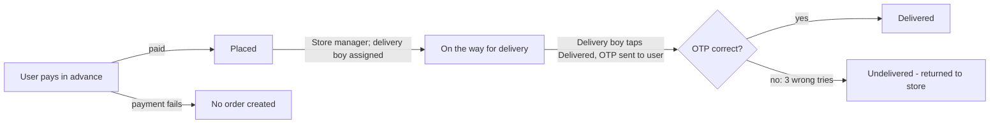

# Business Requirements Document – Product Ordering & Delivery Application

**Date:** 2026-10-07
**Prepared by:** Siddhesh Kasar (Business Analyst)
**Version:** 1.2 – all client answers and standard assumptions applied

---

## 1. Project overview and scope

The client needs an app where a user logs in with a mobile number, searches for products, pays in advance and places an order. The nearest store (within 4 km by road) receives the order and assigns it to a delivery boy. The delivery boy delivers it and closes the order with an OTP.

The application has three modules:

| Module | Used by | Purpose |
| --- | --- | --- |
| User | Customer | Log in, search products, pay in advance, place an order, receive the delivery OTP |
| Store | Store manager | Receive orders, check order time, update status, assign a delivery boy |
| Delivery Boy | Delivery boy | View assigned orders, see the user's address and details, deliver and confirm with OTP |

**In scope**

- Mobile-number + OTP login for all three roles
- Product search
- Order placement with mandatory delivery address and mandatory advance payment
- Routing of each order to the nearest store within 4 km by road
- Order review and status update by the store manager
- Assignment of the order to a delivery boy
- Delivery boy view of the user's address and information
- OTP-based delivery confirmation
- Order status tracking across the lifecycle

**Out of scope**

- Order cancellation (confirmed by client: no cancellation in this phase)
- Refunds through the system (confirmed by client: refunds are handled manually outside the app)
- Self-registration for store managers and delivery boys (their numbers are hardcoded)
- Order rejection by the store (confirmed by client: no reject option for now)
- Delivery charges and minimum order value
- Push notifications for status changes (status is shown in the app)
- Cart, wishlist, coupons, offers, ratings and reviews
- Product, inventory and price management by the store
- Admin panel, reports and analytics
- Live location tracking of the delivery boy
- Cash on delivery or any payment option other than advance payment

---

## 2. User roles and permissions

There are three roles. Each role sees only its own module and only the orders linked to it.

| Permission | User (customer) | Store manager | Delivery boy |
| --- | --- | --- | --- |
| Log in with mobile number + OTP | Yes | Yes (hardcoded number only) | Yes (hardcoded number only) |
| Search products | Yes | No | No |
| Place an order and pay in advance | Yes | No | No |
| Cancel an order | No | No | No |
| Reject an order | No | No | No |
| View own orders and their status | Yes | No | No |
| Receive the delivery OTP | Yes | No | No |
| View orders received by own store | No | Yes | No |
| Check order time | No | Yes | No |
| Assign a delivery boy and set "On the way for delivery" (one action) | No | Yes | No |
| View assigned orders only | No | No | Yes |
| View user's name, mobile number and address for an assigned order | No | Yes | Yes |
| Mark an order as "Delivered" (triggers OTP) | No | No | Yes |
| Resend the delivery OTP | No | No | Yes |
| Enter the OTP given by the user | No | No | Yes |

---

## 3. Functional requirements

Each requirement has a unique ID: FR-U (User), FR-S (Store), FR-D (Delivery Boy), FR-G (General). All items are Must, since each comes straight from the client's requirement or answers.

### 3.1 User module

| ID | Requirement |
| --- | --- |
| FR-U-01 | The system shall let the user log in using a 10-digit Indian mobile number. |
| FR-U-02 | The system shall verify the mobile number with a one-time login OTP before granting access. |
| FR-U-03 | The system shall let the user search for products by name. |
| FR-U-04 | The system shall show matching products in the search results. |
| FR-U-05 | The system shall let the user select one or more products and place an order. |
| FR-U-06 | The system shall require one delivery address per order, with a mandatory pincode, before the order can be placed. |
| FR-U-07 | The system shall check that at least one store is within 4 km by road of the delivery address. |
| FR-U-08 | If no store is within 4 km, the system shall show "Currently no store is available in your area" and shall not allow the order or payment. |
| FR-U-09 | The system shall require full advance payment before the order is placed. |
| FR-U-10 | The system shall create the order only after payment succeeds. |
| FR-U-11 | The system shall show the user an order confirmation with an order ID. |
| FR-U-12 | The system shall show the user the current status of each order in the app. |
| FR-U-13 | The system shall send the delivery OTP to the user when the delivery boy marks the order as delivered. |
| FR-U-14 | The system shall not offer an option to cancel an order. |

### 3.2 Store module

| ID | Requirement |
| --- | --- |
| FR-S-01 | The system shall let the store manager log in with a hardcoded mobile number and OTP. |
| FR-S-02 | The system shall route each new order to the nearest store by road distance, within 4 km of the delivery address. |
| FR-S-03 | The system shall show the store manager the list of new orders for that store. |
| FR-S-04 | The system shall show the order details, including the order placed time, to the store manager. |
| FR-S-05 | The system shall let the store manager select a delivery boy of that store and, in the same action, change the order status to "On the way for delivery". |
| FR-S-06 | The system shall not offer the store manager an option to reject an order. |

### 3.3 Delivery Boy module

| ID | Requirement |
| --- | --- |
| FR-D-01 | The system shall let the delivery boy log in with a hardcoded mobile number and OTP. |
| FR-D-02 | The system shall show the delivery boy only the orders assigned to him. |
| FR-D-03 | The system shall show the user's name, mobile number and delivery address for each assigned order. |
| FR-D-04 | The system shall let the delivery boy mark an order as "Delivered". |
| FR-D-05 | When the order is marked "Delivered", the system shall generate an OTP and send it to the user's registered mobile number. |
| FR-D-06 | The system shall let the delivery boy enter the OTP shared by the user. |
| FR-D-07 | The system shall close the order as "Delivered" only when the OTP matches. |
| FR-D-08 | The system shall keep the order as "Undelivered" when the OTP does not match, and allow up to 3 OTP attempts. |
| FR-D-09 | The system shall let the delivery boy resend the delivery OTP up to 2 times. |
| FR-D-10 | After 3 wrong OTP attempts, the order shall stay "Undelivered" and be returned to the store; any refund is handled manually outside the system. |

### 3.4 General

| ID | Requirement |
| --- | --- |
| FR-G-01 | The system shall allow status changes only in the order defined in the order status lifecycle (section 5). |
| FR-G-02 | The system shall allow only hardcoded mobile numbers to log in as store manager or delivery boy. Changing these numbers needs a change by the development team. |

---

## 4. User stories and acceptance criteria

Acceptance criteria use Given / When / Then so each one can be turned into a test case.

| Story ID | User story | Acceptance criteria | Linked FRs |
| --- | --- | --- | --- |
| US-01 | As a user, I want to log in with my mobile number so that I can use the app without a password. | 1. Given a valid 10-digit mobile number, when I request login, then I receive a login OTP. 2. Given the correct OTP, when I submit it, then I am logged in. 3. Given a wrong OTP, when I submit it, then I see an error, stay on the OTP screen and can retry or resend (no account lock). | FR-U-01, FR-U-02 |
| US-02 | As a user, I want to search for products so that I can find what I need. | 1. Given I enter a product name, when I search, then matching products are listed. 2. Given no product matches, when I search, then I see a "No products found" message. | FR-U-03, FR-U-04 |
| US-03 | As a user, I want to enter a delivery address so that the order reaches me. | 1. Given the pincode or basic address details are empty, when I try to proceed, then I cannot continue and the missing fields are highlighted. 2. Given a store is within 4 km, when I proceed, then I move to payment. 3. Given no store is within 4 km, when I proceed, then I see "Currently no store is available in your area" and cannot pay. | FR-U-06, FR-U-07, FR-U-08 |
| US-04 | As a user, I want to pay in advance so that my order is placed. | 1. Given payment succeeds, then the order is created with status "Placed" and I see the order ID. 2. Given payment fails or is cancelled, then no order is created and I see a failure message with an option to retry. | FR-U-05, FR-U-09, FR-U-10, FR-U-11 |
| US-05 | As a user, I want to see my order status so that I know where my order is. | 1. Given I have placed an order, when I open my orders, then I see its current status. 2. When the status changes, then the new status is shown. 3. No cancel option is shown. | FR-U-12, FR-U-14 |
| US-06 | As a store manager or delivery boy, I want to log in with my registered mobile number so that I can access my module. | 1. Given my number is hardcoded in the system, when I enter the correct OTP, then I am logged in to my module. 2. Given my number is not registered, when I request login, then I see "This number is not registered" and no OTP is sent. | FR-S-01, FR-D-01, FR-G-02 |
| US-07 | As a store manager, I want to receive orders for my store so that I can process them. | 1. Given a user places an order, then it appears only in the nearest store's order list (within 4 km by road). 2. Each order shows the order ID, items, delivery address and order placed time. 3. No reject option is shown. | FR-S-02, FR-S-03, FR-S-04 |
| US-08 | As a store manager, I want to assign a delivery boy so that the order gets delivered. | 1. Given an order is "Placed", when I select a delivery boy from my store and confirm, then the status becomes "On the way for delivery". 2. The order then appears in that delivery boy's list. | FR-S-05 |
| US-09 | As a delivery boy, I want to see the user's address and details so that I can reach the user. | 1. Given an order is assigned to me, then I see the user's name, mobile number and address. 2. I cannot see orders not assigned to me. | FR-D-02, FR-D-03 |
| US-10 | As a delivery boy, I want to mark an order as delivered so that the user receives an OTP. | 1. Given I am at the user's location, when I tap "Delivered", then an OTP is sent to the user's registered mobile number. 2. The OTP entry screen opens for me. | FR-D-04, FR-D-05, FR-U-13 |
| US-11 | As a delivery boy, I want to enter the user's OTP so that the delivery is confirmed. | 1. Given the OTP is correct, when I submit it, then the status becomes "Delivered". 2. Given the OTP is wrong, when I submit it, then I see an error, the status stays "Undelivered" and I can try again (up to 3 attempts). 3. Given the user did not get the OTP, when I tap resend, then a new OTP is sent (up to 2 resends). 4. Given 3 wrong attempts, then the order stays "Undelivered" and I return it to the store. | FR-D-06, FR-D-07, FR-D-08, FR-D-09, FR-D-10 |

---

## 5. Order flow and status lifecycle

An order is created only after advance payment succeeds, and it closes as Delivered only when the user's OTP is entered correctly.

### 5.1 End-to-end order flow

1. User logs in with mobile number and OTP.
2. User searches for products and selects them.
3. User enters the delivery address (basic details + mandatory pincode).
4. System checks that a store is within 4 km by road of the address. If not, it shows "Currently no store is available in your area" and stops.
5. User pays the full amount in advance.
6. On payment success, the system creates the order with status **Placed** and sends it to the nearest store.
7. Store manager receives the order and checks the order placed time.
8. Store manager assigns a delivery boy; in the same action the status becomes **On the way for delivery**.
9. Delivery boy sees the order with the user's name, mobile number and address, and delivers it.
10. Delivery boy marks the order as delivered. The system sends an OTP to the user.
11. User shares the OTP; the delivery boy enters it.
12. Correct OTP: status becomes **Delivered**. Wrong OTP: status stays **Undelivered**; after 3 wrong attempts the order goes back to the store and any refund is done manually.

### 5.2 Order status lifecycle

| Status | Set by | When | Next allowed status |
| --- | --- | --- | --- |
| Placed | System | Advance payment succeeds | On the way for delivery |
| On the way for delivery | Store manager | After checking the order time; delivery boy assigned | Delivered or Undelivered |
| Undelivered | System | Delivery boy entered a wrong OTP (3 attempts allowed) | None (final). Order returned to store; refund handled manually |
| Delivered | System | Delivery boy entered the correct OTP | None (final) |

---

## 6. Business rules and validations

Values marked "standard" are standard defaults applied at the client's request.

| Rule ID | Area | Rule / validation |
| --- | --- | --- |
| BR-01 | Login | Mobile number is mandatory, digits only, exactly 10 digits. Indian numbers only (+91 by default); this is a local app. |
| BR-02 | Login | Login OTP is 6 digits and valid for 5 minutes (standard). |
| BR-03 | Login | No account lock. A user can retry or resend the OTP after a wrong attempt. |
| BR-04 | Login | Store managers and delivery boys can log in only with hardcoded mobile numbers and OTP. There is no sign-up for these roles. |
| BR-05 | Order | An order must contain at least 1 product. |
| BR-06 | Address | Delivery address is mandatory. An order cannot move to payment without it. |
| BR-07 | Address | Basic address details are required (house/flat number, street/area, city). Pincode is mandatory and must be 6 digits. |
| BR-08 | Address | At least one store must be within 4 km by road of the delivery address; otherwise show "Currently no store is available in your area" and block the order. |
| BR-09 | Payment | Advance payment of the full order amount is mandatory. There is no pay-later option. Accepted methods: UPI, debit/credit card and net banking (standard). |
| BR-10 | Payment | The order is created and sent to the store only after the payment gateway confirms success. |
| BR-11 | Payment | A failed, cancelled or timed-out payment creates no order. |
| BR-12 | Refund | The system does not process refunds. All refunds are handled manually outside the app. |
| BR-13 | Cancellation | Orders cannot be cancelled by the user or rejected by the store once placed. |
| BR-14 | Store routing | Each order goes to exactly one store: the nearest store by road distance, within 4 km of the delivery address. |
| BR-15 | Store | Only the store manager of the receiving store can change the status to "On the way for delivery" and assign a delivery boy. |
| BR-16 | Assignment | An order is assigned to exactly one delivery boy at a time, from the same store. |
| BR-17 | Delivery | A delivery boy can act only on orders assigned to him. |
| BR-18 | Delivery OTP | The delivery OTP is generated only when the delivery boy marks the order as delivered, and is sent only to the user's registered mobile number. |
| BR-19 | Delivery OTP | Delivery OTP is 4 digits, single-use, unique per order and valid for 10 minutes. Up to 3 attempts and 2 resends are allowed (standard). |
| BR-20 | Delivery OTP | The order becomes "Delivered" only after the correct OTP is entered. A wrong OTP keeps the order "Undelivered". |
| BR-21 | Undelivered | An "Undelivered" order is returned to the store. |
| BR-22 | Status | Status cannot be moved backwards or skipped (see section 5). |
| BR-23 | Charges | No delivery charges and no minimum order value (standard). |

---

## 7. Exception and edge cases

Handling not defined by the client uses standard behaviour (section 9.2).

| ID | Scenario | Expected system behaviour |
| --- | --- | --- |
| EX-01 | Invalid mobile number at login | Show "Enter a valid 10-digit mobile number". Do not send an OTP. |
| EX-02 | Wrong or expired login OTP | Show an error. Allow retry or resend. No account lock. |
| EX-03 | Login OTP SMS not received | User can request a resend after 30 seconds (standard). |
| EX-04 | Unregistered number tries to log in as store manager or delivery boy | Show "This number is not registered". Do not send an OTP. |
| EX-05 | Product search returns nothing | Show "No products found". |
| EX-06 | Pincode or basic address details missing | Block the order. Highlight the missing fields. |
| EX-07 | No store within 4 km by road of the address | Show "Currently no store is available in your area". Do not take payment. |
| EX-08 | Payment fails or is cancelled | No order is created. Show a failure message and a retry option. |
| EX-09 | Payment debited but gateway confirmation not received | No order is created. Refund handled manually outside the app. |
| EX-10 | Product goes out of stock after payment | Store manager calls the user; the order is not delivered and the refund is handled manually (standard). |
| EX-11 | Store manager does not act on the order | No time limit or reject option in the system. The order stays "Placed" until the store assigns a delivery boy. |
| EX-12 | No delivery boy is available | Order stays "Placed" with the store until a delivery boy is assigned. |
| EX-13 | Delivery boy enters a wrong delivery OTP | Show "Incorrect OTP". Status stays "Undelivered". Up to 3 attempts; after the 3rd wrong attempt the order goes back to the store. |
| EX-14 | User does not receive the delivery OTP | Delivery boy taps resend; a new OTP is sent (up to 2 resends). |
| EX-15 | User is not available or refuses the order | Status stays "Undelivered". Order returned to store; refund handled manually. |
| EX-16 | User wants to cancel the order | Not allowed. No cancel option is shown. |
| EX-17 | Delivery boy loses network while entering OTP | Status is not changed until the server confirms the OTP. Delivery boy can retry. |
| EX-18 | Two store managers or two delivery boys act on the same order at once | Only the first valid action is saved; the second sees the updated status. |

---

## 8. Non-functional requirements

Target numbers are standard baselines, applied at the client's request.

| ID | Category | Requirement |
| --- | --- | --- |
| NFR-01 | Security | All data between app and server is encrypted in transit (HTTPS/TLS 1.2 or higher). |
| NFR-02 | Security | OTPs are stored hashed, expire after use or timeout, and are never shown on the delivery boy's screen. |
| NFR-03 | Security | Role-based access: each role can reach only its own module and its own orders (section 2). |
| NFR-04 | Security | The user's address and mobile number are visible to the delivery boy only while the order is assigned to him and not yet delivered. |
| NFR-05 | Security | Card or bank details are handled only by a PCI-DSS compliant payment gateway; the app does not store them. |
| NFR-06 | Security | User sessions expire after a period of inactivity (duration to confirm). |
| NFR-07 | Performance | Product search returns results within 2 seconds for 95% of requests. |
| NFR-08 | Performance | A placed order appears in the store manager's list within 10 seconds of payment success. |
| NFR-09 | Performance | OTP SMS is delivered within 30 seconds for 95% of requests. |
| NFR-10 | Availability | The system is available 99.5% of the time each month. |
| NFR-11 | Reliability | No order is lost or duplicated if the user or delivery boy loses network mid-action. |
| NFR-12 | Usability | Every error message states what went wrong and what to do next, in plain language. |

---

## 9. Decisions and assumptions

### 9.1 Decisions confirmed by client (2026-10-07)

| # | Topic | Decision |
| --- | --- | --- |
| D1 | Store / delivery boy login | Log in with hardcoded mobile number and OTP only, for now. |
| D2 | Nearest store | A store must be within 4 km of the user's address, measured by road. |
| D3 | No store nearby | Show "Currently no store is available in your area". |
| D4 | Order time | The store manager checks the order placed time. |
| D5 | Reject order | No reject option for the store, for now. |
| D6 | Undelivered order | The order goes back to the store. Refund is done manually. |
| D7 | Cancellation and refund | No cancellation for now. No refund from the system. |
| D8 | Mobile number | 10 digits, Indian number by default (local app). |
| D9 | Account lock | No account lock on wrong OTP. |
| D10 | Address | Basic address details are required; pincode is mandatory. |
| D11 | Everything else | Use standard formats and defaults (section 9.2). |

### 9.2 Standard assumptions (applied at client's request)

| # | Topic | Assumption |
| --- | --- | --- |
| A1 | Currency and payment | INR, online only, through a standard Indian payment gateway. Methods: UPI, debit/credit card, net banking. |
| A2 | Products | Products, prices and stock already exist in the system; managing them is not part of this scope. |
| A3 | Stores | Each store has one store manager login and its own set of delivery boys. |
| A4 | Search | Search by product name only. |
| A5 | Address | One delivery address per order. |
| A6 | Out of stock after payment | Store manager calls the user; the order is not delivered and the refund is manual. |
| A7 | Delivery boy assignment | Store manager picks any delivery boy of that store. No limit on orders per delivery boy. |
| A8 | Status and assignment | Assigning a delivery boy and setting "On the way for delivery" is one action. |
| A9 | Notifications | SMS is used only for OTPs. Order status is shown in the app. |
| A10 | Delivery OTP | 4 digits, valid 10 minutes, 3 attempts, 2 resends. |
| A11 | Login OTP | 6 digits, valid 5 minutes, resend after 30 seconds. |
| A12 | Non-functional targets | As listed in section 8. |
| A13 | Platform | One mobile app for Android and iOS, with a separate view for each role after login. |
| A14 | Charges | No delivery charges and no minimum order value. |
| A15 | Hardcoded numbers | Changing store manager or delivery boy numbers needs a change by the development team. |

### 9.3 Open questions

None. All earlier questions are answered by the client (9.1) or covered by standard assumptions (9.2). The client should review 9.2 and flag any assumption that does not fit.
